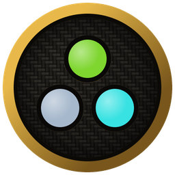

# Forever Nodes 

Every known herb, ore and fishing pool in WoW: Forever on your map, and when and where to train.

  

The panel sits right where the quest log does, with your node list, skill bar and settings in one place. Herbs and veins show on the map, and the Forever Nodes button sits right on it (right-click it to show or hide map icons).

  
  
  
  
  
  
  
  

<b>Gallery</b> (click a picture above, or here to open)

 

The panel sits right where the quest log does, with your node list, skill bar and settings in one place. Herbs and veins show on the map, and the Forever Nodes button sits right on it (right-click it to show or hide map icons).

 

Your skill bar shows your rank at a glance and glows when you're ready to train. Click it for the closest and cheapest trainers for your next rank (reputation discounts included), then click a trainer to drop a pin on your map.

 

In range, a node's minimap icon turns into a marker you design: a dot, a circle and their borders, each with its own size, width and radius. Color it by profession, difficulty, node type or custom. Smart detection handles your minimap's size and shape.

 

See the skill a node needs, colored by difficulty, on the world map, the minimap and herbs and veins in the world. Each tooltip has its own settings (placement, style and color), with a live preview.

 

Forever Nodes matches your UI automatically, or pick Native or Dark yourself in Settings &gt; Interface. More themes are on the way, and requests are welcome. Tell me which UI you use and I'll help it fit right in.

 

Quick access to everything gathering. Left-click to open the panel, right-click to show or hide map icons. Drag it anywhere on the map or lock it in Settings &gt; Interface. With OpenMap, star it to add it to the map's button tray.

 

With OpenMap (by jigrobbulus), Forever Nodes switches to Dynamic mode by itself: dots zoomed out, icons zoomed in, and bigger under your cursor. Star it in OpenMap's menu to put it on the map's button tray, with right-click for map icons.

 

A full look at the settings revamped in v1.5.4: four tidy sections (Look &amp; Feel, Behavior Tweaks, Tooltips, Interface) and new options to color nodes by profession, difficulty, node type or a custom color.

 

 

━━ ◈ ━━&nbsp;&nbsp;&nbsp;<b>Made exclusively for WoW: Forever</b>&nbsp;&nbsp;&nbsp;━━ ◈ ━━

 

## How to Install

- **CurseForge:** [Forever Nodes](https://www.curseforge.com/wow/addons/forever-nodes) or the CurseForge app.
- **Manually:** extract the [latest release](https://github.com/LvcidLabs/ForeverNodes/releases) into `World of Warcraft\_forever_\Interface\AddOns\`.

 

## Features

Forever Nodes puts every known herb, ore and fishing pool in WoW: Forever on your minimap and world map, with a panel docked right where your quest log sits. It shows your skill at a glance, tells you when you're ready to train and where the nearest trainer is, and only shows what you're tracking, so your map stays clean. Everything is customizable from the gear at the top right of the panel.

- **Preloaded nodes** that grow as you gather new spots
- **Skill bar and trainer finder** with map pins and reputation discounts
- **World map styles:** icons, dots, or Dynamic dots that grow as you zoom
- **Nearby marker** on your minimap, built your way
- **Colors** by profession, difficulty, node type or your own
- **Skill levels on tooltips** in the world, on the map and the minimap
- **Matches your UI** (stock or EllesmereUI) and works with OpenMap

 

## Getting Started

Open your world map and the quick tutorial will show you around. Type `/fn help` to see it again.

 

## Commands

- `/fn` opens the panel
- `/fn help` shows the quick tutorial
- `/fn style` picks your nearby marker style
- `/fn version` shows the version and what's new

`/fnodes` and `/forevernodes` work the same as `/fn`.

 

## Feedback

Missing or misplaced node? [Open an issue](https://github.com/LvcidLabs/ForeverNodes/issues) with the zone and coordinates.

 

## Credits

- Inspired by **GatherMate2**.
- Node data and icons are based on **GatherLite** by Wuild (MIT).
- Uses HereBeDragons, LibStub, CallbackHandler, LibDataBroker and LibDBIcon. See [CREDITS.txt](CREDITS.txt).

 

## License

[MIT](LICENSE) © Lvcid. The bundled libraries in `Libs` keep their own licenses, and the node data and icons based on GatherLite keep its MIT notice (see [CREDITS.txt](CREDITS.txt)).
